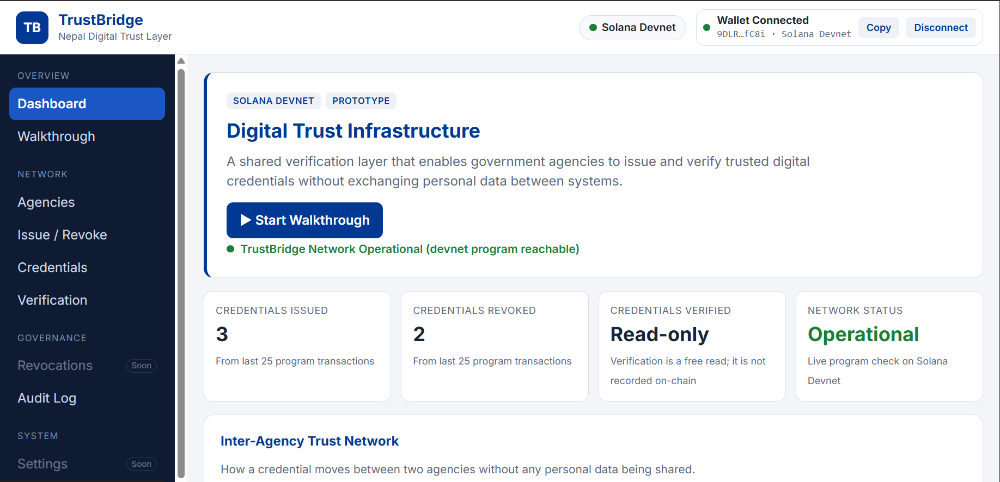
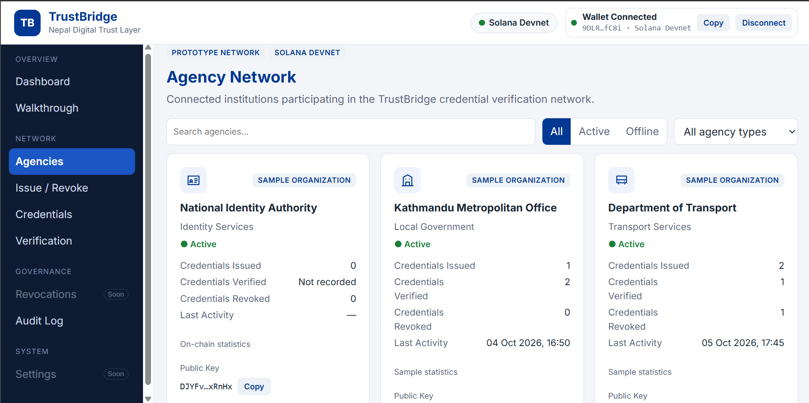
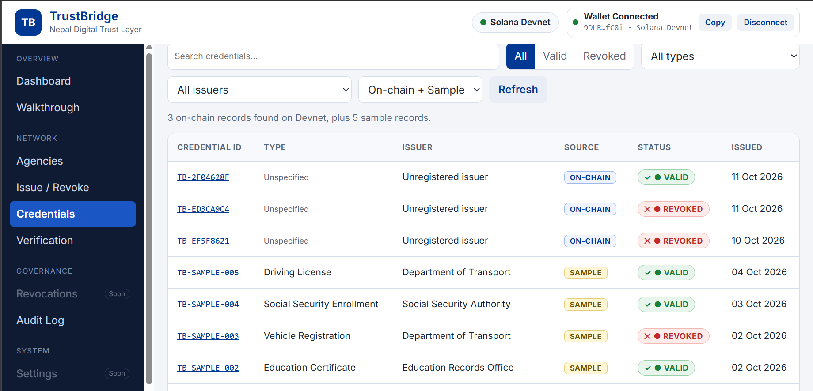
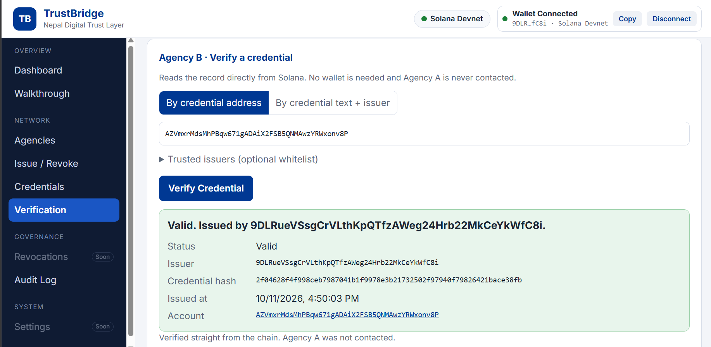

::: {align="center"}
# TrustBridge

### A verifiable-credential trust layer for inter-agency verification

**Issue once. Verify independently. Keep personal data off-chain.**

[](https://solana.com/)
[](https://www.anchor-lang.com/)
[](https://react.dev/)
[](https://www.typescriptlang.org/)

```{=html}
<!-- SCREENSHOT PLACEHOLDER 1: Replace the path below with your main dashboard screenshot. -->
```


*A Solana-based proof of concept for verifying the authenticity and
current validity of credentials without requiring the verifier to
contact the issuing agency.*
:::

------------------------------------------------------------------------

## Table of contents

-   [The problem](#the-problem)
-   [The solution](#the-solution)
-   [How it works](#how-it-works)
-   [Features](#features)
-   [Screenshots](#screenshots)
-   [Technology stack](#technology-stack)
-   [Repository structure](#repository-structure)
-   [Prerequisites](#prerequisites)
-   [Local setup](#local-setup)
-   [Run the frontend](#run-the-frontend)
-   [Build and test the Solana
    program](#build-and-test-the-solana-program)
-   [Deploy to Devnet](#deploy-to-devnet)
-   [Demo walkthrough](#demo-walkthrough)
-   [Configuration and environment
    variables](#configuration-and-environment-variables)
-   [Privacy and security
    considerations](#privacy-and-security-considerations)
-   [Current limitations](#current-limitations)
-   [Roadmap](#roadmap)
-   [Contributing](#contributing)
-   [License](#license)

## The problem

A document or address verified by one public agency may still need to be
checked manually when another agency needs to rely on it. Separate
systems do not automatically share a common way to verify that a
credential was issued by a particular issuer and has not been revoked.

This can create repeated checks, delays, and dependence on the issuing
agency being available.

## The solution

**TrustBridge** is a proof of concept that anchors a cryptographic hash
of a credential on the Solana blockchain. An issuer can create a record,
and a verifier can check that record directly against the
blockchain---without calling the issuer's server.

TrustBridge is designed around a simple principle:

> Store proof on-chain, not citizens' personal information.

The project uses fictional/demo data for demonstration. It is not an
official Nepal Government service and is not production-ready identity
infrastructure.

## How it works

1.  **Issue:** An authorized wallet submits a credential hash to the
    Solana program.
2.  **Anchor:** The program creates a Program Derived Address (PDA)
    containing the issuer public key, credential hash, validity state,
    and lifecycle timestamps.
3.  **Verify:** A verifier reads the on-chain record and checks whether
    the credential is currently valid.
4.  **Revoke:** The original issuer can revoke its credential.
    Subsequent verification should report it as invalid.
5.  **Audit:** Transaction signatures can be opened in Solscan to
    inspect the on-chain actions.

### On-chain record

The Anchor program's `CredentialRecord` stores:

-   Issuer public key
-   Credential SHA-256 hash
-   Validity status
-   Issued timestamp
-   Revocation timestamp
-   PDA bump

The PDA is derived using the seeds:

``` text
["credential", issuer_public_key, credential_hash]
```

The frontend hashes credential text in the browser. The user's wallet
signs blockchain transactions. There is no application backend or
database in the current architecture.

## Features

-   **Credential issuance:** Create a credential record from the issuer
    view.
-   **Independent verification:** Verify using a credential PDA or
    credential text plus issuer information.
-   **Revocation:** Allow the original issuer to revoke a credential.
-   **Phantom wallet integration:** Connect a wallet and sign supported
    transactions.
-   **Agency directory:** Browse agency information and demo agency
    profiles.
-   **Credential registry:** View on-chain records alongside clearly
    labelled fictional demo entries.
-   **Credential detail pages:** Inspect hashes, issuers, lifecycle
    information, PDA addresses, and available explorer links.
-   **Activity/history views:** Review supported recent activity and
    transaction links.
-   **Dashboard:** View project status, trust-flow information, and
    available registry/activity summaries.

Some dashboard statistics and agency entries are demo data. The
interface labels demo records; do not present them as real government
records.

## Screenshots

### Dashboard


### Agency directory



### Credential registry



### Credential verification




Recommended folder layout:

``` text
trust-bridge/
├── README.md
└── docs/
    └── images/
        ├── dashboard.png
        ├── agencies.png
        ├── credentials.png
        ├── verification.png
        └── wallet-issue.png
```

## Technology stack

  Area                  Technology
  --------------------- --------------------------------
  Blockchain            Solana
  Smart contract        Rust, Anchor
  Frontend              React, TypeScript, Vite
  Wallet                Solana Wallet Adapter, Phantom
  Program interaction   Anchor client, Solana Web3.js
  Credential hashing    SHA-256 in the browser
  Network for demo      Solana Devnet
  Explorer              Solscan

## Repository structure

``` text
trust-bridge/
├── Anchor.toml
├── Cargo.toml
├── package.json
├── .env.example
├── programs/
│   └── trust_bridge/
│       └── src/
│           └── lib.rs              # Anchor program
├── tests/
│   └── trust_bridge.ts             # Program tests
├── scripts/
│   ├── deploy-devnet.sh            # Devnet deployment helper
│   ├── diagnose-deploy.sh          # Deployment diagnostics
│   └── devnet-smoke.ts             # Devnet issue/verify/revoke flow
├── app/
│   ├── .env.example
│   ├── package.json
│   └── src/
│       ├── components/             # UI components
│       ├── data/                   # Agency and demo credential data
│       ├── idl/                    # Frontend program IDL
│       ├── lib/                    # Program, registry, wallet and hash helpers
│       └── pages/                  # Main app pages
└── docs/
    └── images/                     # Add README screenshots here
```

## Prerequisites

Install the following before running the full project:

-   **WSL 2 with Ubuntu** (recommended for the Solana/Rust toolchain on
    Windows)
-   Git
-   Rust toolchain
-   Solana CLI version compatible with the project's Anchor toolchain
-   Anchor CLI **0.31.1** (as specified by this project)
-   Node.js and npm
-   Yarn for root-level scripts/tests
-   Phantom wallet browser extension, configured for **Devnet** for a
    devnet demo
-   Optional: a Helius API key for a dedicated RPC endpoint

> Version compatibility matters. This project specifies Anchor 0.31.1
> and Solana 2.1.0 in `Anchor.toml`. Avoid mixing multiple Solana/Anchor
> installations on your `PATH`. Check your installed versions before
> troubleshooting.

## Local setup

### 1. Open the project in Ubuntu

If using WSL, keep the working copy in Ubuntu's Linux filesystem, for
example:

``` bash
cd ~/trust-bridge
```

Avoid building from a Windows-mounted OneDrive directory if you
experience slow builds or file-system issues.

### 2. Install root dependencies

From the repository root:

``` bash
yarn install
```

### 3. Configure the root environment

Create your local environment file:

``` bash
cp .env.example .env
```

Edit `.env` and set the values required by the deployment or smoke-test
scripts. Do not commit `.env`.

Example keys are documented in `.env.example`. The deployment wallet
must be a **devnet-only wallet with no valuable funds**.

### 4. Build the program

``` bash
anchor build
```

### 5. Run the program tests

``` bash
anchor test
```

The test command starts a local validator and runs the test script
configured in `Anchor.toml`. If it fails, capture the complete error and
validator logs before changing versions or deleting files.

## Run the frontend

From the repository root:

### 1. Install frontend dependencies

``` bash
npm run app:install
```

### 2. Create the frontend environment file

``` bash
cp app/.env.example app/.env.local
```

Edit `app/.env.local` if needed. The app can use the public Devnet RPC
if a Helius key is not configured, although rate limits or limited
history may affect the demo.

### 3. Synchronize the program IDL

After building the Anchor program, run:

``` bash
npm --prefix app run sync-idl
```

This copies the generated program IDL into the frontend. If the program
ID changes after a redeployment, synchronize the IDL again and check the
program ID configuration.

### 4. Start the Vite development server

``` bash
npm run app:dev
```

Open the local URL printed by Vite, normally:

``` text
http://localhost:5173
```

For a production frontend build, run:

``` bash
npm run app:build
```

## Build and test the Solana program

Useful commands from the repository root:

``` bash
anchor --version
solana --version
rustc --version
node --version
npm --version
yarn --version
```

Build:

``` bash
anchor build
```

Test against a local validator:

``` bash
anchor test
```

The project contains tests in `tests/trust_bridge.ts`. A successful
build proves the program compiles; a successful test run is a separate
check that the local validator and test suite ran correctly.

## Deploy to Devnet

**Only deploy with a dedicated devnet wallet. Never use a wallet that
holds real funds.**

1.  Confirm the Solana CLI is configured for Devnet:

    ``` bash
    solana config set --url devnet
    solana config get
    ```

2.  Check the configured wallet address and Devnet SOL balance:

    ``` bash
    solana address
    solana balance
    ```

3.  Configure the root `.env` as required by the deployment script. Do
    not paste private keys, seed phrases, or secret environment values
    into issues, screenshots, or chat.

4.  Run the project's deployment helper:

    ``` bash
    npm run deploy:devnet
    ```

5.  Optionally run the end-to-end smoke test:

    ``` bash
    npm run smoke:devnet
    ```

If deployment fails, run the diagnostic helper and inspect its output:

``` bash
./scripts/diagnose-deploy.sh
```

Review the script output before sharing it publicly to ensure no secrets
or private local paths are included. The deployment helper may require a
valid Helius API key and a correctly configured wallet.

## Demo walkthrough

Use fictional data only. The sample credential text below is
illustrative; do not use real personal information.

1.  Start the frontend and connect Phantom with the wallet set to
    Devnet.
2.  Open the issuer view (Agency A).
3.  Enter a non-sensitive demo credential and issue it.
4.  Show the transaction signature and open the transaction in Solscan.
5.  Open the verifier view (Agency B) and verify the new credential.
6.  Return to the issuer view and revoke the credential.
7.  Verify it again and show that the credential is now invalid.
8.  Explain that verification reads the on-chain record rather than
    asking the issuing agency's server.

Actual UI labels and behavior may differ as the app evolves. Confirm
each step works on the current deployment before presenting it in a live
demo.

## Configuration and environment variables

### Root `.env`

Copy `.env.example` to `.env`. The example file documents:

-   `HELIUS_API_KEY`: optional/provider API key used by deployment or
    smoke-test tooling.
-   `ANCHOR_WALLET`: path to the local Solana keypair used for
    deployment and smoke testing.

Example path in the sample configuration:

``` dotenv
ANCHOR_WALLET=/home/rishav/.config/solana/trustbridge-devnet.json
```

Change this path to the location of your own **devnet-only** keypair. Do
not paste the keypair JSON contents into `.env`; use the path only.

### Frontend `app/.env.local`

Copy `app/.env.example` to `app/.env.local`. It documents:

-   `VITE_HELIUS_API_KEY`: optional Helius API key for Devnet RPC
    access.
-   `VITE_SOLANA_RPC_URL`: optional full RPC URL; when set, it takes
    precedence over the Helius key.
-   `VITE_PROGRAM_ID`: optional expected program ID for a configuration
    check.
-   `VITE_DEMO_AGENCY_A_PUBKEY`: optional public key for the demo
    issuer, if used by the current app configuration.

Vite variables prefixed with `VITE_` are exposed to the browser bundle.
**Never put private keys, seed phrases, passwords, or other secrets in
frontend environment variables.**

## Privacy and security considerations

-   The current program stores a credential hash and issuer/lifecycle
    metadata on-chain, not the credential text itself.
-   A hash is not automatically anonymous. If an attacker can guess a
    credential's contents, they may hash guesses and compare them with
    public records.
-   Production use should consider per-credential salts or a stronger
    privacy-preserving credential design, with sensitive mapping data
    kept off-chain.
-   Revocation authorization is intended to be restricted to the
    original issuer.
-   Issuer authenticity and trust policy are separate concerns: a
    verifier still needs a clear policy for deciding which issuer public
    keys it trusts.
-   Use mock data for demonstrations. Do not upload citizens' real
    documents or personal data to Devnet or any public blockchain.
-   Keep private keys and seed phrases private. If a seed phrase has
    ever been exposed, treat that wallet as compromised and create a new
    wallet.

## Current limitations

-   This is a proof of concept, not a production government identity
    system.
-   Some agency profiles, registry entries, and displayed statistics are
    demonstration data, not official records.
-   Devnet is a public testing network and may be reset or behave
    differently from mainnet.
-   A frontend build, a program build, local tests, and a successful
    Devnet deployment are distinct milestones; verify each separately.
-   A production deployment would need additional security review,
    issuer onboarding and governance, key management, privacy analysis,
    operational monitoring, and accessibility testing.

## Roadmap

Possible next steps:

-   [ ] Add a formal trusted-issuer registry or governance mechanism.
-   [ ] Define issuer onboarding, rotation, suspension, and recovery
    procedures.
-   [ ] Improve privacy with per-credential salts or privacy-preserving
    proofs.
-   [ ] Add automated integration tests against a controlled Devnet
    workflow.
-   [ ] Improve error reporting and transaction status feedback.
-   [ ] Add deployment verification and reproducible release
    instructions.
-   [ ] Complete security, accessibility, and usability reviews before
    any real-world use.

## Contributing

1.  Fork the repository.
2.  Create a feature branch.
3.  Make a focused change and test it.
4.  Open a pull request describing the change and test results.

Never include secrets, wallet keypair files, `.env` files, generated
build output, or real personal data in a commit.

## License

The root `package.json` currently declares `ISC`. Add the full license
text and confirm the intended project license before distributing the
project.
